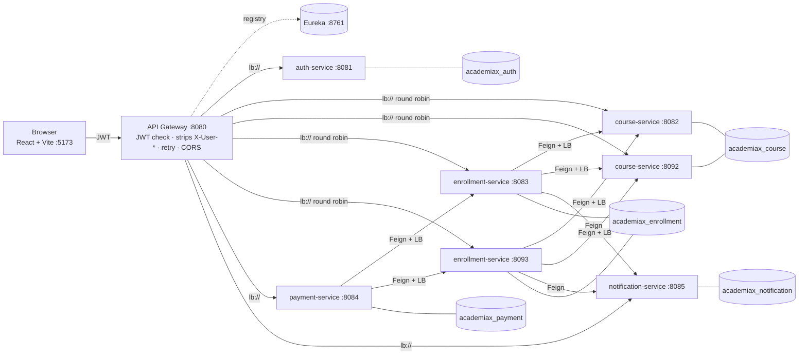
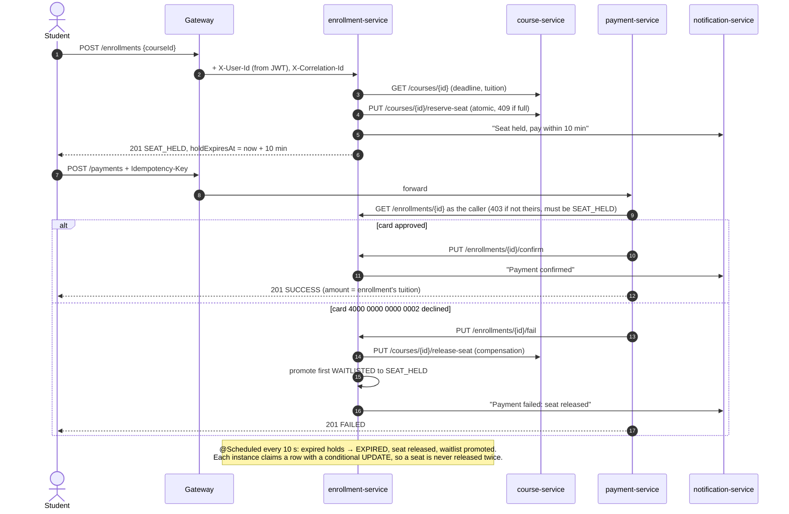

# AcademiaX: Course Enrollment & Tuition Processing

Higher-education course enrollment and tuition processing (problem statement **PS035**), built as Spring Boot microservices behind a Spring Cloud Gateway, with a React frontend styled like a printed university course catalogue.

**What makes it more than CRUD:**
- **Seat-hold saga.** Holding a seat, paying, confirming, and compensating (seat released) on decline or timeout run across four services, with a waitlist that auto-promotes.
- **Atomic seat allocation.** A conditional `UPDATE … WHERE available_seats > 0` means 20 simultaneous requests for 5 seats give exactly 5 winners, even across two course-service instances.
- **Visible load balancing.** Two instances each of course- and enrollment-service, every response tagged `X-Served-By`, and a System Console that charts the round-robin split and traces one request across all services.
- **Hardened JWT.** Rotating refresh tokens with reuse detection, lockout, gateway-stripped identity headers, and ownership rules enforced in every service.

---

## Architecture



Every service registers with Eureka. All state lives in MySQL (one schema per service), so instances are interchangeable and any of them can serve any request.

## Seat-hold saga



State machine (illegal transitions return **409**):

| From | Allowed next |
|---|---|
| `WAITLISTED` | `SEAT_HELD`, `CANCELLED` |
| `SEAT_HELD` | `CONFIRMED`, `PAYMENT_FAILED`, `EXPIRED`, `CANCELLED` |
| `CONFIRMED` | `CANCELLED`, `REFUNDED` |
| `PAYMENT_FAILED`, `EXPIRED` | `SEAT_HELD`, `CANCELLED` |
| `CANCELLED`, `REFUNDED` | (terminal) |

## Ports

| Component | Port(s) | Notes |
|---|---|---|
| Frontend (Vite dev / nginx in Docker) | 5173 | |
| API Gateway | 8080 | the only port the browser talks to |
| Eureka | 8761 | dashboard at http://localhost:8761 |
| auth-service | 8081 | |
| course-service | **8082, 8092** | two instances |
| enrollment-service | **8083, 8093** | two instances |
| payment-service | 8084 | |
| notification-service | 8085 | |
| MySQL | 3306 local / 3307 from Docker | Docker host port is configurable: `$env:MYSQL_HOST_PORT=3308` |

## Environment variables

All values live in **`.env`** in the project root (copy `.env.example`). `run-local.ps1`, VS Code and Docker Compose all read the same file. There are no secret defaults in the YAML: a missing or short `JWT_SECRET` stops the gateway and auth-service at startup.

| Variable | Used by | Purpose |
|---|---|---|
| `JWT_SECRET` | gateway, auth | HMAC key, **≥ 32 bytes**. Generate with `openssl rand -base64 48` |
| `DB_USERNAME`, `DB_PASSWORD` | all data services | MySQL credentials |
| `DB_HOST` | all data services | `localhost` locally (set by the script), `mysql` in Docker |
| `ADMIN_EMAIL`, `ADMIN_PASSWORD`, `ADMIN_NAME` | auth | the one ADMIN account created on first start |
| `CORS_ALLOWED_ORIGINS` | gateway | comma-separated origins, default `http://localhost:5173` |
| `PORT` | every service | HTTP port (second instances use 8092 / 8093) |
| `SEED_DATA` | course, enrollment | `false` on second instances so only one seeds |
| `EUREKA_URL` | every service | default `http://localhost:8761/eureka/` |
| `JWT_EXPIRATION`, `JWT_REFRESH_EXPIRATION` | auth | ms; defaults 15 min and 7 days |
| `VITE_API_URL` | frontend build | gateway URL baked into the bundle (default `http://localhost:8080`) |

## Run it (Windows, PowerShell)

**Prerequisites:** JDK 17+ (21 recommended), Maven 3.9+, Node 18+, MySQL 8 on port 3306. Docker Desktop is only needed for option B.

```powershell
Copy-Item .env.example .env
notepad .env          # set DB_PASSWORD to your MySQL root password, and a JWT_SECRET of 32+ characters
```

### Option A: one script, no Docker (what the demo uses)

```powershell
.\run-local.ps1
```

This builds the backend, starts each service in its own window in dependency order (Eureka → auth/course/notification/payment → second course instance → enrollment ×2 → gateway), waits for every health check, and finally starts the frontend. Open http://localhost:5173.

```powershell
.\stop-local.ps1      # stops everything run-local started
```

Flags: `-SkipBuild` reuses the last build; `-NoFrontend` starts the backend only.

If PowerShell refuses to run scripts, allow them for this window only: `Set-ExecutionPolicy -Scope Process Bypass`.

### Option B: Docker Compose

```powershell
docker compose up --build
```

MySQL and Eureka have health checks and every service waits on `service_healthy`, so the order is automatic. The first build takes several minutes.

If port 3307 is taken (for example by an older AcademiaX container), pick another host port for MySQL:

```powershell
$env:MYSQL_HOST_PORT=3308; docker compose up --build
```

Stop with `docker compose down`. Add `-v` to also delete the database volume, so the next start reseeds.

### Option C: VS Code Run panel

Open the folder in VS Code (Extension Pack for Java installed). In **Run and Debug**, start `eureka-server` first, then launch the compound **"AcademiaX: whole backend"**. It reads `.env` through `envFile`.

### Seed data (created on first start)

| Role | Email | Password |
|---|---|---|
| Admin | value of `ADMIN_EMAIL` (default `admin@academiax.edu`) | value of `ADMIN_PASSWORD` |
| Instructors (3) | `instructor1@academiax.edu` … `instructor3@academiax.edu` | `Instr@123` |
| Students (10) | `student1@academiax.edu` … `student10@academiax.edu` | `Student@123` |

12 courses across Computer Science, Mathematics and Physics. The demo scenarios are there from the first start:
- **CS301** (6 seats) is **full with 2 students waitlisted**.
- **CS499** (10 seats) is **nearly full**, with one seat left.
- **MATH101**'s enrollment **deadline has passed**.
- 24 confirmed enrollments with matching payments, created through the real saga so seats, rosters and revenue agree.

Test cards on the checkout page: `4242 4242 4242 4242` approves; `4000 0000 0000 0002` is always declined.

## API overview (through the gateway, http://localhost:8080)

| Area | Endpoints | Who |
|---|---|---|
| Auth | `POST /auth/register` (always STUDENT) · `POST /auth/login` · `POST /auth/refresh` (rotates) · `POST /auth/logout` · `POST /auth/logout-all` · `GET /auth/sessions` · `GET/PUT /auth/profile` | public / self |
| Users | `GET /auth/users` · `POST /auth/users/instructors` · `PUT /auth/users/{id}` · `PUT /auth/users/{id}/status?active=` · `GET /auth/users/stats` | ADMIN |
| Directory | `GET /auth/instructors` (public) · `GET /auth/directory?ids=` | staff |
| Courses | `GET /courses?keyword&department&semester&level&availableOnly&sort&page&size` · `GET /courses/{id}` · `GET /courses/whoami` | public |
| | `POST /courses` · `PUT /courses/{id}` · `DELETE /courses/{id}` (soft, 409 if active enrollments) | ADMIN, or INSTRUCTOR for **own** courses |
| Enrollments | `POST /enrollments` · `POST /enrollments/waitlist?courseId=` · `GET /enrollments/my` · `GET /enrollments/{id}` · `PUT /enrollments/{id}/cancel` | the student (IDOR-checked) |
| | `GET /enrollments/course/{id}/roster` | ADMIN or the course's instructor |
| | `GET /enrollments?status&courseId&studentId&page` · `GET /enrollments/stats` | ADMIN |
| Payments | `POST /payments` (`Idempotency-Key`) · `GET /payments/my` · `GET /payments/{id}` · `POST /payments/{id}/refund` | the student |
| | `GET /payments` · `GET /payments/stats` | ADMIN |
| Notifications | `GET /notifications/my` · `GET /notifications/unread-count` · `PUT /notifications/{id}/read` · `PUT /notifications/read-all` | self |
| System | `GET /admin/registry` · `GET /admin/trace/{correlationId}` · `GET /admin/circuitbreakers` | ADMIN |

Saga-internal endpoints (`/courses/{id}/reserve-seat`, `/enrollments/{id}/confirm|fail|refund`, `POST /notifications`, …) are reachable only service-to-service; the gateway answers **403** if a client calls them.

Every error uses one shape: `{ timestamp, status, error, message, path, correlationId, fieldErrors }`.

Swagger UI (with the bearer scheme) is on each service: e.g. http://localhost:8082/swagger-ui.html.

## Tests

```powershell
cd backend; mvn test                 # unit + integration tests, H2 in-memory
node scripts/smoke-test.mjs          # 46 end-to-end checks against the running stack
node scripts/concurrency-demo.mjs    # 20 students race for 5 seats through the gateway
```

Results are in [docs/TEST_REPORT.md](docs/TEST_REPORT.md). The Postman collection is in [postman/](postman/): import the collection plus `AcademiaX.local.postman_environment.json`, then run it in the Collection Runner.

## Troubleshooting

| Symptom | Fix |
|---|---|
| **Docker: `port is already allocated` for 3307** | Another MySQL container is using it. Set `$env:MYSQL_HOST_PORT=3308` before `docker compose up`. |
| **Port already in use** (`Web server failed to start. Port 8082 was already in use`) | `.\stop-local.ps1`, or find the owner: `Get-NetTCPConnection -LocalPort 8082 \| Select OwningProcess` then `Stop-Process -Id <pid>` |
| **Eureka shows a service DOWN or missing** | Give it 10–15 s (lease renewal is 5 s, expiry 10 s). Check that service's window for a startup error. Services retry registration, so start Eureka again if it was down. |
| **MySQL: `Public Key Retrieval is not allowed` / auth plugin error** | Already handled by `allowPublicKeyRetrieval=true` in the JDBC URLs. If MySQL rejects the login, check `DB_PASSWORD` in `.env`. Old MySQL 5 clients may need `ALTER USER 'root'@'localhost' IDENTIFIED WITH caching_sha2_password BY '<pwd>';`. |
| **CORS error in the browser console** | The frontend origin must be listed in `CORS_ALLOWED_ORIGINS` (default `http://localhost:5173`). Restart the gateway after changing `.env`. |
| **`JWT_SECRET environment variable is missing or shorter than 32 bytes`** | Set a 32+ character `JWT_SECRET` in `.env`. This failure is intentional. |
| **Build fails with `TypeTag :: UNKNOWN`** | An old Lombok on a new JDK. The project pins Lombok 1.18.42, which supports JDK 17–25; run `mvn -v` to check which JDK Maven uses. |
| **Seed data missing** | Seeding runs only on empty schemas. To start fresh, drop `academiax_auth`, `academiax_course`, `academiax_enrollment`, `academiax_payment`, `academiax_notification` and restart. |

## Repository layout

```text
backend/            Maven multi-module: eureka-server, api-gateway, auth, course, enrollment, payment, notification
frontend/           React 18 + Vite + Tailwind ("University Registrar, editorial" design)
frontend/legacy-ui/ The Review 1 / first-draft pages, kept for reference (not built)
postman/            Collection + environment (+ generator script)
scripts/            smoke-test.mjs, concurrency-demo.mjs
docs/               REVIEW2_DEMO.md (demo script), TEST_REPORT.md
deploy/             Single-VM deployment notes
run-local.ps1 / stop-local.ps1, .vscode/launch.json, docker-compose.yml
```

Payments are simulated for an academic demo; no real card is ever charged.
